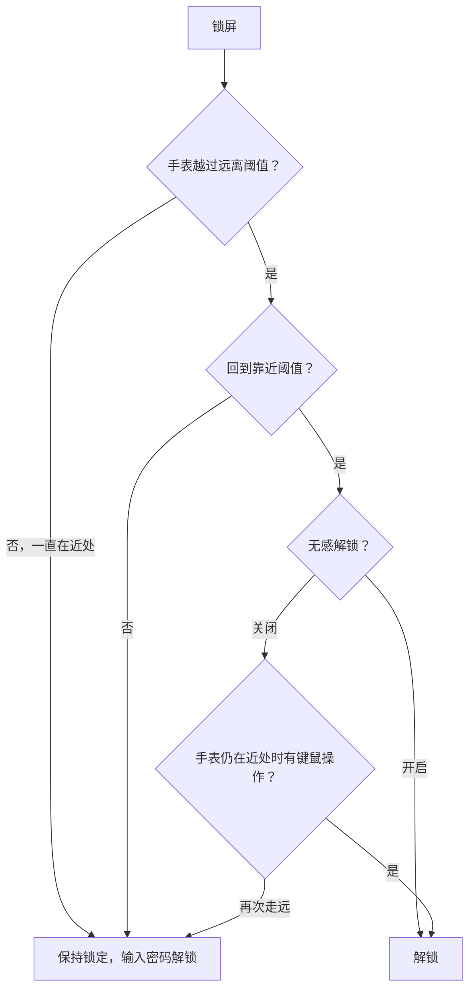

# Watch Unlock Windows

用 Apple Watch 解锁 Windows：戴着手表走开，电脑锁屏；走回来，电脑自动解锁。

## 使用

1. 从 [Releases](https://github.com/whyy1/watch-unlock-windows/releases) 下载 `Watch.Unlock_x.y.z_x64-setup.exe` 并运行，批准一次管理员确认，按向导完成安装。之后从开始菜单打开 **Watch Unlock**。卸载时，在“设置 → 应用”里找到它即可。
2. 在「附近扫描」中打开配对窗口，然后在手表的“设置 → 蓝牙”里选择这台电脑，并确认 Windows 弹出的配对请求。
3. 在“Windows 已配对设备”里点「绑定此设备」，批准管理员确认，让手表靠近电脑，最多等 30 秒。
4. 在概览页填写 Windows 账户密码。注意要填账户密码，不是 PIN。
5. 锁屏，走远，再走回来，电脑就会解锁。

距离阈值可以在“我的设备”里调整。RSSI 受遮挡影响很大，建议在自己的环境里试几次再定。

## 解锁规则

- **只有“先离开、再回来”才会解锁。** 锁屏后手表信号低于远离阈值，就记为离开；回到靠近阈值时触发解锁。锁屏后一直待在电脑旁，不会自动解锁，需要照常输入密码。
- **无感解锁**（按设备设置，默认开启）：
  - 开启：靠近后立即解锁。
  - 关闭：回来后要动一下键盘或鼠标才解锁。手表一直在近处时，会一直等你操作；再次走远，这次返回就作废。
- **开机自启**：概览页的开关默认开启，每次登录 Windows 都会自动启动后台。重启后的第一次登录仍需手动输入密码，因为那时后台还没运行。
- **通知**（可选）：解锁后通过 [Bark](https://apps.apple.com/app/id1403753865) 推送一条提醒。通知不参与解锁判断。



## 密钥与安全

账户密码、每块手表的 IRK、Bark 密钥分别用 Windows DPAPI 按当前账户加密，保存在 `%LOCALAPPDATA%\WatchUnlockWindows\`，目录只有你和 SYSTEM 能访问。其他账户读不到这些文件，硬盘被拆走后，没有你的账户密码也解不开。

密码必须能还原，因为登录时要把真实密码交给 Windows 校验。后台只在以下条件都满足时才交出密码：
- 请求来自同一会话里的系统登录界面（SYSTEM `LogonUI`）；
- 后台自身运行在只有管理员可写的 `Program Files` 目录。

绑定手表时，程序经管理员确认，一次性读取 Windows 保存的这块手表的 IRK，并用实时广播验证；IRK 不会出现在命令行、日志或界面里。

这套保护能防住其他账户和离线读取，**防不了已经以你的身份运行的恶意程序**。

## 局限

- **读不到手表是否戴着、是否解锁。** 实测四种状态下，手表的蓝牙广播内容完全相同。所以手表没戴，或者被别人拿着走近，同样可能触发解锁。
- **防不了广播重放和中继。** 判断只依据手表身份（IRK）和信号强度（RSSI），安全性不如 Apple 官方的 Auto Unlock。
- **RSSI 不等于距离。** 墙体、人体遮挡和手表朝向都会影响信号，偶尔会误判离开或返回。
- **关闭无感解锁，也不能确认是本人在操作。** 手表在近处时，别人动一下键鼠同样会解锁。
- 不支持远程桌面会话；安装包没有代码签名。

**已实测**（Windows 11 Pro + Apple Watch）：一键绑定，走远返回解锁（约 0.17 秒），无感解锁关闭时等待键鼠操作，原地锁屏不解锁。
**未实测**：同时绑定两块手表，休眠或蓝牙故障后的恢复，切换用户。

## 开发

```text
apps/desktop/            Tauri 界面
backend/crates/domain    距离策略（纯逻辑）
backend/crates/watchd    后台：蓝牙扫描、会话监测、秘密存储、通知
backend/crates/provider  Windows 登录组件（Credential Provider）
scripts/                 构建、隐私检查、第三方许可清单
```

```powershell
./scripts/Build.ps1 -Action test       # 后端测试
./scripts/Build.ps1 -Action package    # 全部测试，生成安装程序 dist/Watch Unlock_x.y.z_x64-setup.exe
```

环境要求、GNU 工具链参数和开发调试方式见 [docs/development.md](docs/development.md)。如果要接入其他手表，实现 `backend/crates/watchd/src/adapters.rs` 里的 `DeviceAdapter` 即可，距离策略、凭据和登录组件都可以复用。

## 许可

本项目基于 [xiaoka520/watch-unlock-windows](https://github.com/xiaoka520/watch-unlock-windows)（修订 `157f8eb`）修改，按 [GNU AGPL v3](LICENSE) 发布，来源与修改说明见 [NOTICE](NOTICE)。你可以使用、修改和商业分发本项目；分发修改版本时，需要同时提供对应源码，并保留 `LICENSE`、`NOTICE` 和 `licenses/`。用 `Build.ps1 -Action package` 打出的安装包已经包含这些内容。

Apple Watch、iPhone、Windows 等名称只用来说明兼容性，本项目与 Apple 无关。
